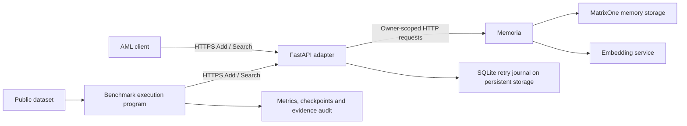

# Memory Benchmarks

[](https://github.com/matrixorigin/memory_benchmarks/actions/workflows/aml-ci.yml)

Public memory benchmarks, an Agent Memory Leaderboard (AML) Add/Search adapter,
and a dedicated dev deployment for [Memoria](https://github.com/matrixorigin/memoria).

This repository helps the team evaluate how well Memoria retrieves evidence from
conversation histories. It prepares public datasets, writes the original history
through `/add`, queries `/search`, and records retrieval metrics and run checkpoints.
It also owns the adapter and its Aliyun dev deployment pipeline.

**Current evaluation mode: retrieval diagnostics.** Answer generation, native
answer/coding scores, and official AML leaderboard scores are separate work.

## Start here

| Task | What you need | Instructions |
|---|---|---|
| Try the deployed API | Adapter access key | [API quick start](#try-the-deployed-api) |
| Run a benchmark in Actions | Workflow access; configured adapter access key | [Run a benchmark](#run-a-benchmark) |
| Develop the adapter locally | Python 3.12+, uv, running Memoria, master key | [Local development](#local-development) |
| Deploy or update services | Configured deployment Secrets and Variables | [Deployment](#deploy-or-update-services) |
| Understand the design | No runtime credentials | [Competition design](agent_memory_leaderboard/docs/competition-plan.md) |

## How it works



- **Adapter:** maps each `user_id` to a stable Memoria owner. Add synchronously
  writes messages and checks visibility; Search returns ranked evidence across
  that user's sessions.
- **Memoria:** stores and retrieves memories in MatrixOne, with embedding configured
  on the backend. The adapter's SQLite journal tracks retries and recovery state.
- **Benchmark execution program:** ingests original history and evaluates retrieved
  evidence against local labels. Gold answers and relevance labels stay outside
  Add/Search requests.
- **GitHub Actions runner:** the machine that executes that program. Deployment,
  offline checks, and live benchmarks have separate workflows.

The dev deployment runs one adapter Pod and one dedicated Memoria Pod, with a
persistent journal, NGINX Ingress, and cert-manager TLS. MatrixOne and embedding
capacity are shared infrastructure. Astra is optional for future answer/judge work.

## Try the deployed API

The dev endpoint is **`https://aml.cn-dev.matrixone.tech`**. Obtain
`AML_ADAPTER_API_KEY` from the environment maintainer through a private channel.
API clients use this adapter key; backend and deployment credentials stay with
the operators.

### Write a memory, then search it

The example uses curl and Python 3 to generate a fresh test user. Replace the key
placeholder before running; keep the same user for Add and Search.

```sh
export AML_BASE_URL='https://aml.cn-dev.matrixone.tech'
export AML_ADAPTER_API_KEY='<your-adapter-access-key>'
export AML_DEMO_USER="aml-demo-$(python3 -c 'import uuid; print(uuid.uuid4().hex)')"

curl --fail-with-body -sS "$AML_BASE_URL/ready"

curl --fail-with-body -sS --max-time 120 "$AML_BASE_URL/add" \
  -H "Authorization: Bearer $AML_ADAPTER_API_KEY" \
  -H 'Content-Type: application/json' \
  --data-binary @- <<JSON
{
  "request_id": "eval:demo:conv-0:chunk-0",
  "user_id": "$AML_DEMO_USER",
  "session_id": "session-1",
  "messages": [
    {"role": "user", "content": "Orion project uses Rust for the server."}
  ]
}
JSON

curl --fail-with-body -sS --max-time 120 "$AML_BASE_URL/search" \
  -H "Authorization: Bearer $AML_ADAPTER_API_KEY" \
  -H 'Content-Type: application/json' \
  --data-binary @- <<JSON
{"user_id": "$AML_DEMO_USER", "query": "What language does the Orion server use?", "top_k": 10}
JSON
```

Add returns HTTP 200 with `success: true` and echoes `request_id`, `user_id`, and
`session_id`. Search returns `{"data": [...]}` containing evidence records with
`id` and `content`; `score` and `created_at` are optional. No matches returns
`{"data": []}`. Search does not generate an answer.

`request_id` is an opaque string. Retry the same write with its original user,
ID, and complete payload; changing the payload under the same ID returns 400.
Messages accept `user`/`assistant` roles and optional integer Unix-millisecond
timestamps. The example writes persistent data under a random test user and does
not automatically clean it up.

| Endpoint | Purpose |
|---|---|
| `POST /add` | Authenticated, synchronous history ingestion |
| `POST /search` | Authenticated evidence retrieval; same `user_id` as Add |
| `GET /health` | Adapter liveness |
| `GET /ready` | Journal readability and upstream Memoria health |
| `GET /docs` | Interactive request/response documentation |

Healthy probes alone do not validate authentication, model calls, or retrieval
quality. The dev deployment and seven-check live API integration smoke passed on
2026-10-06; the [acceptance record](agent_memory_leaderboard/docs/competition-plan.md#当前交付状态)
contains the actual revisions and remaining validation scope.

For the complete field contract and Python example, see
[public integration](deploy/README.md#接入已部署的-addsearch). For retry and error
semantics, see the [adapter guide](agent_memory_leaderboard/README.md#retries-and-deployment-state).

## Run a benchmark

Open **Actions → AML benchmark → Run workflow** and select the `main` branch.
The workflow uses the configured `AML_ADAPTER_API_KEY` Secret; you do not paste a
key into the run inputs.

| Input | First-run value | Meaning |
|---|---|---|
| `dataset` | `locomo` | LoCoMo-Refined; `longmemeval` selects LongMemEval-S |
| `histories` | `1` | First N complete histories from the pinned dataset; allowed 1–10 |
| `top_k` | `100` | Retrieval limit; allowed 1–100 |
| `runtime_label` | Blank | Optional nonsecret backend version note; report only, supplied by the operator |

One history can contain many sessions, messages, and questions. The full selected
history is written before querying it; `histories=1` does not mean one question.
Start with one history, then increase the scope after checking resource use.

The workflow pins data revisions and verifies file size and SHA256. Its backend
label is optional, operator supplied, and **not automatically verified** against the live
service. Leaving it blank records `null` and displays **Not recorded** in the summary.
It does not select or deploy a backend: the benchmark calls the currently deployed
Add/Search endpoint at `https://aml.cn-dev.matrixone.tech`.
It shares a concurrency group with deployment to prevent workflow-based
updates during the benchmark; external clients still require team coordination.

After the run:

1. Open **Summary** for metrics, per-history/category breakdown, versions, and failure status.
2. Download **`aml-benchmark-<run-id>-<attempt>`** for the report/checkpoint,
   selection, summaries, and evidence ID/hash audits. Artifacts last 30 days.
3. A failed run reports completed work only. Another run creates a new UUID scope;
   it does not automatically resume or clean the earlier run.

Requests are serial and execution has a 120-minute limit. Backend memories and
journal entries require their own retention/cleanup plan; artifact expiry does
not delete them. Runs use our database, embedding, and Actions resources; they do
not consume official AML Full quota.

See the [benchmark workflow guide](agent_memory_leaderboard/benchmarks/CI.md)
for data provenance, metric definitions, timeout and resume behavior.

### Interpreting the metrics

| Metric | Range / direction | What it measures |
|---|---|---|
| Mean evidence recall | 0–1, higher is better | Average fraction of gold evidence retrieved for labeled questions |
| Recall@K | 0–1, higher is better | Evidence recall from the first K returned records of the same Search response; new reports only |
| All evidence hit rate | 0–1, higher is better | Fraction of labeled questions with all gold evidence retrieved |
| Empty results | Count | Successful Search requests returning no evidence |
| Mean returned evidence records | Count per successful Search | Retrieval volume; interpret recall alongside Top K and evidence budget |
| Search P50 / P95 | Seconds, lower is faster | Client-observed successful Search latency, including retries |
| Completed Add chunks | Count | History batches successfully accepted by the adapter |

Unlabeled questions are excluded from recall; unavailable metrics appear as
`N/A`. LoCoMo uses message evidence, while LongMemEval-S uses session evidence,
so scores are dataset-specific. Dataset categories are not AML's seven leaderboard
capability dimensions. Native answer accuracy, Token F1, BLEU-1, and coding success
require additional answer generation and dataset-specific evaluation.

## Dataset coverage

Dataset guides describe preparation, supported variants, and limitations. This
table describes implementations in this repository, not official benchmark scores.

| Dataset | Current local evaluation | Actions |
|---|---|---|
| [LoCoMo-Refined](agent_memory_leaderboard/benchmarks/textual/locomo_refined/README.md) | Dialogue evidence recall; multimodal questions skipped | Pilot supported |
| [LongMemEval-S](agent_memory_leaderboard/benchmarks/textual/longmemeval_s/README.md) | Session evidence recall; abstention quality needs Answer/Eval | Pilot supported |
| [BEAM](agent_memory_leaderboard/benchmarks/textual/beam/README.md) | Message evidence recall across public history-length variants | Local runner |
| [CLBench](agent_memory_leaderboard/benchmarks/textual/clbench/README.md) | Endpoint diagnostics; evidence recall unavailable | Local runner |
| [PersonaMem-v2](agent_memory_leaderboard/benchmarks/textual/personamem_v2/README.md) | 32k text history diagnostics; native scoring pending | Local runner |
| [SWEContextBench](agent_memory_leaderboard/benchmarks/coding/swecontextbench/README.md) | Historical-issue evidence recall; patch evaluation pending | Local runner |
| [ScriptMem](agent_memory_leaderboard/benchmarks/textual/scriptmem/README.md) | Blocked in this checkout: authorized original conversations required | Unavailable |
| [LongMemEval-Refined](agent_memory_leaderboard/benchmarks/textual/longmemeval_refined/README.md) | Exact refined corpus not verified in this checkout | Unavailable |
| [CAMBench Coding](agent_memory_leaderboard/benchmarks/coding/cambench/README.md) | Corpus and verifier unavailable in this checkout | Unavailable |

Local entrypoints share `src/benchmark.py`. Adding a dataset means implementing
its parser under `benchmarks/textual/` or `benchmarks/coding/`, registering it in
`src/datasets.py`, and documenting ingestion exclusions and metric semantics.
Actions support also needs pinned source/preparation configuration and input validation.

## Local development

Requirements: **Python 3.12+**, **uv**, Linux/macOS, and a running compatible Memoria
HTTP service with its database and model configuration. Start the adapter:

```sh
git clone https://github.com/matrixorigin/memory_benchmarks.git
cd memory_benchmarks/agent_memory_leaderboard
uv sync --locked
export MEMORIA_URL='http://127.0.0.1:8100'
export MEMORIA_MASTER_KEY='<your-local-memoria-master-key>'
export ADAPTER_API_KEY='<a-separate-local-adapter-key>'
export MEMORIA_NAMESPACE='local-dev-v1'
export ADAPTER_STATE_DIR='./var'
uv run uvicorn src.app:create_app --factory --host 127.0.0.1 --port 8000
```

Use `http://127.0.0.1:8000` as the client base URL and the configured adapter key.
Environment files are not automatically loaded by the application. Preserve the
journal directory across restarts and keep it stable during a run.

`AML_ADAPTER_API_KEY` is the deployment/client credential name; the Python adapter
and benchmark program read it as `ADAPTER_API_KEY`. The adapter and full integration
smoke also need the Memoria master key. Retrieval evaluation does not require an
answer-generation LLM or reranker.

The [adapter guide](agent_memory_leaderboard/README.md) covers configuration,
local integration smoke, benchmark commands, and a Memoria Docker Compose overlay.

## Deploy or update services

Use **Actions → AML Aliyun dev deployment → Run workflow**, branch `main`.

| Setting | Options / behavior |
|---|---|
| `operation` | `preview` previews resource changes; `deploy` applies them |
| `deployment_target` | `both`, `memoria`, or `memory_benchmarks` (the adapter) |
| `memoria_build_mode` | `source`, `image`, or `configured` (uses configured mode) |
| `memoria_ref` | Memoria branch, tag, or SHA; blank uses configured ref, default `main` |

Memoria defaults to a source build from `matrixorigin/memoria/main`; the actual
checkout commit is recorded, and deployment uses the image digest. Initial
deployment needs `both`; single-service updates retain the unselected service's
deployed image and configuration. Shared credential/configuration changes need
`both`. Updates use Recreate and can interrupt requests.

Memoria source builds run only in this deployment workflow when the target is
`both` or `memoria` and the resolved mode is `source`. Adapter-only updates and
`image` mode skip Memoria builds. Ordinary PRs and merges do not build Memoria
in offline CI; a main push can still build it if automatic deployment is enabled.

The workflow manages the dedicated `memory-benchmarks/new-dev` Pulumi stack and
`aml-memory-benchmarks` namespace. Operators configure the dedicated SQL account,
runtime credentials, ACR access, cluster identity, ingress, and TLS issuer.
Automatic deployment is off by default; formal evaluation requires a release
freeze. Preview also builds/pushes images and can initialize an empty stack.

See [deployment setup and operations](deploy/README.md) for Secret/Variable setup,
database bootstrap, selective updates, DNS/certificates, and acceptance checks.

## Workflows at a glance

| Workflow | Trigger | Result |
|---|---|---|
| [AML offline CI](.github/workflows/aml-ci.yml) | Matching PRs/pushes or manual | Lint, tests, workflow/chart validation, adapter image build and Pulumi checks; no Memoria build, live benchmark or deployment |
| [AML Aliyun dev deployment](.github/workflows/aml-dev-deploy.yml) | Manual; main push when explicitly enabled | Publish images and preview/update the dev stack |
| [AML benchmark](.github/workflows/aml-benchmark.yml) | Manual, main only | Call deployed Add/Search and publish retrieval reports |

## Repository layout

```text
memory_benchmarks/
├── .github/workflows/          # Offline CI, dev deployment, manual benchmark
├── agent_memory_leaderboard/
│   ├── src/                   # Adapter, journal, HTTP client, shared benchmark program
│   ├── benchmarks/            # Parsers, preparation, entrypoints and CI guide
│   ├── scripts/               # Local launchers and Actions preparation/reporting
│   ├── tests/                 # Adapter and benchmark tests using simulated backends
│   ├── docs/                  # Maintained design and review references
│   └── compose.adapter.yaml   # Overlay for Memoria Docker Compose
└── deploy/
    ├── chart/                 # Helm resources for Memoria and adapter
    ├── pulumi/                # Independent dev stack and configuration template
    ├── docker/                # Memoria source-build Dockerfile
    └── scripts/               # Bootstrap, configuration, preflight and release helpers
```

Downloaded data, reports, environment files, actual cluster configuration, and
credentials are excluded from Git. Follow each dataset's source and usage terms
when obtaining or sharing its data.

## Design and contribution

The maintained [competition design](agent_memory_leaderboard/docs/competition-plan.md)
records architecture, decisions, verified delivery status, and remaining work.
Detailed guides own operational instructions; this README is the project entrypoint.

Explain the design, validation evidence, and effect on API behavior or evaluation
comparability in each PR. Preserve provenance and user isolation, keep gold data
outside ingestion, and distinguish diagnostics from native benchmark scores.
The [adapter guide](agent_memory_leaderboard/README.md#verify) documents local checks;
offline CI validates changes without using live deployment credentials.
