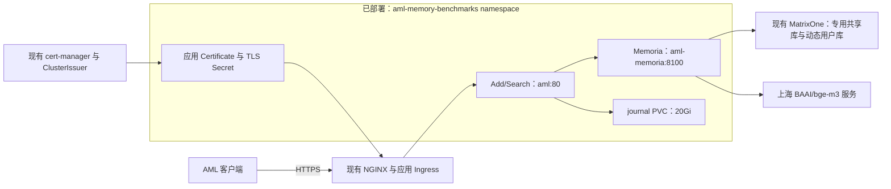

# AML 文本赛道：共建方案与工作计划

## 工作范围

团队在 [matrixorigin/memory_benchmarks](https://github.com/matrixorigin/memory_benchmarks) 共建参评适配、评测和部署工程，基于同事现有实现继续开展工作。本文是后续方案与设计决策的维护入口；更新有效章节，区分已实现、待实施和验证证据，不记录中间讨论。

根目录 [README](../../README.md) 是新成员的项目入口，沿用英文，集中说明用途、当前架构、
公网 Add/Search 最小示例、手动评测及部署步骤、数据集支持范围和指标语义。
运维凭据／发布细节由 `deploy/README.md` 维护，评测参数／产物／保留规则由
`benchmarks/CI.md` 维护，本文维护设计及验收状态。首页支持表区分可执行检索、接口诊断、
未取得数据和未接入原生评分；不以数据集目录存在或 workflow 成功表述正式 AML 分数。

此前独立的 Memoria `feat/aml-text-adapter` 分支、`aml-local-client` 和相关优化／评测计划停止推进。已有代码、PR、文档和结果保留为参考，不删除或关闭；不以完成旧计划或迁入旧实现作为新项目的前置条件。后续是否采用其中的代码或用例，由新项目的具体任务决定。

## 参评赛道与多模态边界

本项目参评范围为 **Textual Memory（文本记忆）**。AML 官方将文本、代码、多模态
作为独立评测类型；文本赛道关注长对话、跨会话事实、多跳关系、时间、个性化、规则、
记忆治理及 Streaming，图像／Base64 内容数组属于多模态赛道。
范围依据：[AML 官方文档与参赛说明](https://agentmemories.ai/zh-cn/docs)，2026-10-06 核对。

当前不增加图片存储、视觉模型或图文检索。公开 LoCoMo-Refined 同时含多模态题目，
本项目的文本诊断按原始 `is_multi_modality` 标记跳过这部分题目，单独报告跳过数量，
不计作文本检索失败、不进入召回率分母。该公开数据筛选是本地评测的实现，不能据此
认定完全复现 AML 内部选题或评分；正式文本 Full 的任务范围以官方配置为准。
后续评测扩展仅纳入文本任务和文本能力回归，不要求多模态或代码赛道能力。

参赛组别与模型要求仍需按最新官方材料对齐。2026-10-07 核对时，官方 Full checklist
已写 Open-source Methods 的 Add 阶段期望使用 `gpt-4o-mini`；赛事 FAQ 仍采用
学术／工业分类，学术榜 embedding 指定 `text-embedding-v4`，开放权重模型建议工业榜。
不能继续笼统写“模型规则完全未出现”，也不能自行将两套组别名称等同。上海 bge-m3
的正式参评资格、纯存储且不调用 LLM 的 Add 是否适用该要求，仍需官方明确；当前
运行配置是开发验证配置，不作为合规确认。[官方文档](https://agentmemories.ai/zh-cn/docs)、
[赛事 FAQ](https://agentmemoryleaderboard.ai/competition/)

## CI/CD 交付概要与 Review 入口

CI/CD、Memoria 部署模板和自动证书配置已合入 `memory_benchmarks` 的 `origin/main`。
**Memoria 与适配器已部署到阿里云 dev，公网 HTTPS 和真实 Add/Search 最小联调通过。**
具体运行、实际 SHA／digest 和剩余验收范围见[当前交付状态](#当前交付状态)。
部署操作、Actions 参数及可复制的公网 curl／Python 示例见
[发布与接入说明](../../deploy/README.md#发布流程)和[Add/Search 接入](../../deploy/README.md#接入已部署的-addsearch)。

### 完成状态

| 部分 | 代码／配置状态 | 已执行的工作 | 待验证／待完成 |
|---|---|---|---|
| 离线 CI | 单个 `checks` job 执行 Ruff、pytest、Helm lint／template、适配器镜像构建、Go Pulumi 检查；八个健康探针用例；不构建 Memoria | 已有 CI 运行通过，pytest 为 154 passed、1 warning；Helm 3.17.4 两组检查及适配器镜像构建通过 | 当前提交以 PR checks 为准；CI 不推送镜像或部署 |
| benchmark workflow | 手动选择 LoCoMo／LongMemEval-S、固定数据校验、Summary 与 artifact；Recall@K 及逐题审计 | 修复后 LoCoMo 3 个历史的 101 个 Add／242 次 Search、LongMemEval-S 首个历史的 69 个 Add／1 次 Search 完整通过 | 本地代码已补标签隔离、可选 Answer/Eval、预算内召回和重试观测；新契约尚未运行验收，无正式质量分数 |
| dev CD | main 手动 preview／deploy、冻结检查、单项更新选择；独立 build／deploy runner；自动部署默认关闭 | 首次完整 CD 及固定镜像单项更新成功，适配器 Pod 保留 | 新版源码模式端到端发布仍待验收 |
| Memoria 部署 | 源码／现成镜像模式、分支选择、版本记录及数据库／embedding 配置 | main 源码产物以固定 digest 更新成功，新 Pod Ready，单项更新保留适配器 | 源码构建与部署的 runner 磁盘预算、未知写入恢复仍待验收 |
| Add/Search 部署 | Deployment、Service、journal PVC 和 `/ready` | PVC Bound；公网真实 Add/Search 七项最小联调通过 | 持久性、未知写入恢复及容量仍待验收 |
| 数据库 | 专用用户／角色／共享库初始化及动态用户库授权 | 权限边界、共享及用户 schema 初始化、真实写入／检索通过 | 恢复及保留期限／物理清理仍待验收 |
| GitHub 配置 | 运行凭据／环境变量配置，上海 embedding key 为必填 | 本次部署验证集群、Pulumi、ACR、数据库及应用认证链路 | 未来凭据轮换与权限变更重新验收 |
| HTTPS | Ingress、Certificate 和证书 Ready 等待 | DNS 与入口匹配，证书 Ready，公网健康检查和 Add/Search 通过正常 TLS 校验 | 真实 SLB 长请求超时仍待验收 |

已有完整构建验证见 [Actions run 37452656686](https://github.com/matrixorigin/memory_benchmarks/actions/runs/37452656686)，对应 `c54dc53`，2026-10-06 检查和当时的 Memoria 源码构建 job 均通过，pytest 为 154 passed、1 warning。当前离线 CI 只保留 `checks`，Memoria 源码构建由发布 workflow 执行，后续提交的验证以对应 PR checks 为准。上述离线记录本身不证明上线；实际发布证据见当前交付状态。

交付范围包括 `.github/`、`deploy/`、`/ready`、测试和本目录方案文档；后续变更继续通过 PR
交付到 `origin/main`。实际 dev 配置、凭据和本地运行产物排除提交。

## 本地质量闭环与诊断设计

实现与操作说明统一见[评测与诊断](../benchmarks/EVALUATION.md)；Actions 配置见
[benchmark workflow](../benchmarks/CI.md)。以下能力已在本地开发分支实现，尚未建立
新契约下的真实质量基线，不能以旧运行结果作为这些代码的验收证据。

### 输入隔离与来源归属

runner version 2 只写入原始文本、角色、speaker 和来源日期；不把来源 ID、gold、
`answer_` session 标签、QA 摘要或 judge 规则写入记忆。LME 使用中性本地 session ID，
映射不进入 Add/Search。共享纯函数保留原适配器的 role/time header 和 UTF-8 分片规则，
由此生成本地 SHA256 来源 manifest。wire 请求／响应字段和后端存储语义不变。

检索结果按完整内容 hash 匹配。无法匹配或多个来源存在相同内容时，不猜测归属，
不计来源命中，并单独报告 unmapped／ambiguous 数。一个 LME session 内重复文本仍
可唯一归属该 session。该诊断方法适用于当前保留原文的 Memoria 适配器；改写型记忆
系统必须另行实现可靠的来源归属，不能直接把 hash 不匹配等同于检索失败。

新契约拒绝旧标签运行的 resume，使用新的 run UUID；旧结果可读，但不与新输入
直接做算法优劣比较。gold 异常标签仍原样披露，不在这轮自动修正。

### 可选 Answer/Eval

默认 retrieval 仅调用 Add/Search。answer-eval 为 LoCoMo／LongMemEval-S 增加独立的
OpenAI-compatible 回答／裁判客户端，凭据不经过适配层。模型、endpoint、temperature、
prompt/scorer version、token encoding、输入／输出预算进入运行契约；密钥不进入报告。
gold 只进入评分器／裁判，不进入回答模型。按 LME 问题类别使用不同的本地 rubric，
LoCoMo 显示 Token F1 与 BLEU-1；本地 judge 明确不宣称原生评分器等价或官方 AML 分数。
原生 evaluator 对齐和正式模型资格确认仍是独立验收项。

预算为包含指令、角色、问题、选项／问题日期、证据的整个回答输入，上限 117760，
按固定 o200k_base 加 256 token 余量计数；它是本地近似，不保证等于任意模型的实际
chat template/tokenizer。保留完整证据排名前缀，不跳过较大前置记录挑选后面的证据。
报告预算内来源召回和上游 token usage；实际输入超过预算时失败。实际 usage 在响应后
取得，因此此检查不能避免所有超限调用成本。正式可比基线前仍需确认模型计数契约。

回答正文及检索上下文只存 private cache，用于 judge 失败后的续跑；artifact 只保存
答案 hash、数值指标与安全诊断。CI private cache 在 artifact root 外，不上传。
本地 pending 续跑需要保留该 cache，CI artifact 本身不包含完整 Answer/Eval 恢复材料。
缓存、backend/journal 都受作业保留要求约束，不依赖 artifact 过期完成清理。

### 重试观测与增量断点

每个 Add/Search HTTP attempt 都记录固定状态／原因码、耗时、是否重试和请求标识 hash，
不持久化 headers、原始 payload、响应正文或异常文字。Summary 展示中间尝试，便于
定位恢复后的 503；不因记录了 503 就推断索引延迟或未知写入。重试集合、最多六次尝试
和相同 Add request_id 的恢复语义保持原状。

每题独立文件使用私有权限与原子替换，运行中 header 不再包含不断增长的 questions；
最终报告合并一次，保留现有读取方式。resume／硬中断 Summary 合并完整题目文件；
请求日志可修复尾部撕裂写。Search 完成先落 pending 断点，回答缓存成功后才进入 judge；
进程在模型结果持久化前中断仍可能重做该模型调用。

### 时间回归与容量工具

`src.probes` 默认只生成计划，不发送请求；显式 execute 才运行隔离的合成用例。
时间用例带实际 AML 毫秒 timestamp，覆盖旧、近期、新旧混合和 T1 假设阈值两侧。
可选直接 owner-scoped Explain 只保存允许的路径 flags、数量和时延；它是另一次请求，
不宣称必然与此前公开 Search 同路径。不修改 observed_at 或置信度衰减行为。

容量工具限制逻辑请求数、并发、QPS、输入字节和调度时长，报告各 route 延迟及错误。
逻辑 QPS 不包含内部重试，调度到期不取消已在途的写入。DB／模型压力、物理存储增长
需要配合基础设施指标另行测量。只有实际一次成功 HTTP attempt 超过五分钟，才标记
长请求链路验证通过；多次短重试累计超时不计通过。

验收状态：新代码尚未运行 benchmark 或容量验收。验收顺序为离线行为验证，再以
新契约执行小集；未知写入的后端幂等契约、embedding 实际 token 上限、原生评分和
正式 AML 验收继续按 Issue #1 推进。

## 源码导航

| 入口 | Review 内容 |
|---|---|
| [离线 CI](../../.github/workflows/aml-ci.yml) | 触发条件、依赖锁定、检查／构建步骤和独立于发布凭据的运行范围 |
| [dev CD](../../.github/workflows/aml-dev-deploy.yml) | 分支限制、并发、Secret 使用、镜像 digest、preview／deploy、证书等待及临时文件清理 |
| [Memoria 来源配置](../../deploy/memoria-source.json)、[镜像选择与记录](../../deploy/scripts/memoria_image.py)、[构建 Dockerfile](../../deploy/docker/memoria.Dockerfile) | 默认 main、分支／tag／commit 选择、实际 SHA 与 digest、编译器／运行镜像和构建缓存 |
| [Pulumi 程序](../../deploy/pulumi/main.go)、[配置模板](../../deploy/pulumi/Pulumi.new-dev.example.yaml)、[私有配置生成](../../deploy/scripts/dev_config.py) | 目标集群、私有标识、独立 stack、资源所有权、DSN 编码、Secret 传播、PVC 保护与 Helm 依赖 |
| [更新范围选择](../../deploy/scripts/deployment_target.py)、[Pulumi 配置选择](../../deploy/pulumi/selection.go)、[选择回归用例](../../deploy/tests/test_deployment_target.py) | 首次完整发布、未选应用版本／配置保留、共享凭据与 chart 变动检查、构建后复查 |
| [Memoria 模板](../../deploy/chart/templates/memoria.yaml) | 镜像入口、非 root／只读文件系统、显式多库、共享库连接与授权、模型环境变量及健康探针 |
| [适配器模板](../../deploy/chart/templates/deployment.yaml)、[Service](../../deploy/chart/templates/service.yaml) | 单副本 Recreate、journal 挂载、Secret checksum、请求结束与重启行为 |
| [Ingress](../../deploy/chart/templates/ingress.yaml)、[Certificate](../../deploy/chart/templates/certificate.yaml) | NGINX 路由、长请求配置、TLS Secret 名和现有 ClusterIssuer 的引用 |
| [集群检查](../../deploy/scripts/preflight.py) | API Server／UID 校验、权限与存储检查、域名范围和 Issuer Ready 条件 |
| [数据库初始化](../../deploy/scripts/bootstrap_db.py) | 管理员配置解析、专用用户／角色的权限、重复执行和凭据保留 |
| [GitHub 配置脚本](../../deploy/scripts/configure_github.py) | 固定仓库和目标集群、stdin 上传及错误输出中的凭据保护 |
| [适配器源码](../src/app.py) | 新增 `/ready` 的开销、失败行为和健康状态语义 |
| [冻结检查](../../deploy/scripts/deployment_guard.py)、[Helm 渲染](../../deploy/scripts/render_chart.py)、[ready 用例](../tests/test_ready.py) | 冻结输入校验、两组非秘密渲染配置，以及健康／失败返回码 |
| [发布操作说明](../../deploy/README.md) | 必填配置、执行步骤、外部依赖和验收流程 |

Review 使用源码、部署模板、非秘密配置及已记录的执行证据。管理员 `.env`、`deploy/.runtime.env` 和 kubeconfig 包含真实凭据，不纳入方案或 Review 产物。

### Review 重点

1. **工作流能否执行**：Actions 表达式、依赖／版本、Go 编译、镜像构建、digest 传递和 Pulumi 参数是否一致。离线 CI 及首次完整 CD 的镜像发布、digest 传递和 Pulumi 执行已通过，实际版本见当前交付状态。
2. **发布范围是否正确**：只操作指定 unit 集群及独立 stack；集群身份检查、应用 namespace、共享资源引用和删除保护是否完整。
3. **Memoria 能否启动并供适配器调用**：固定镜像是否具备普通 `/v1/memories` 路径所需的 owner、metadata 和 query 能力；运行参数、schema 初始化、数据库角色权限和 embedding 环境是否满足该版本。
4. **状态与恢复是否可靠**：SQLite 单写者、PVC 绑定／权限、Recreate、发布中断、凭据更新及已有 journal 的保留；确认 `protect` 不等价于备份或恢复方案。
5. **公网链路是否成立**：域名、DNS solver 范围、Certificate／Secret／Ingress 关联和 Ready 等待；SLB 与 NGINX 的真实长请求限制仍需验收。
6. **验证边界是否清楚**：`/ready` 只覆盖 journal 可读及上游健康接口；新数据库登录成功不证明 Memoria 迁移或 Add/Search 可用。既有比赛质量／幂等问题按下文独立跟踪。

### 部署架构

Memoria 默认从源码 `main` 分支构建，由本项目 CD 部署，也可指定分支、tag、commit 或现成镜像；源码构建、镜像推送、dev 部署及公网 Add/Search 最小联调已通过。构建适配由本仓库 Dockerfile 完成，运行问题驱动的 Memoria 两项修复已另行合并并部署，见后文。数据库引擎、模型服务、NGINX 和证书控制器是既有基础设施。详细设计和资源边界见下文，具体配置与操作见发布说明。

## 当前工程与职责

同事原始审查版本为 `b037c42`；当前核实代码为 `origin/main@478ad09`，运行结果分别
关联各自的 benchmark commit 和实际后端镜像。完整逐项结论见
[Issue #1 当前核实结论](review-issue-1.md)，不将旧版问题列表直接当作当前任务状态。

| 部分 | 职责与当前状态 |
|---|---|
| `memory_benchmarks/agent_memory_leaderboard` | 已有 FastAPI Add/Search、SQLite 幂等 journal、隐私保护、断点执行、多数据集解析和检索诊断 |
| Memoria | 作为记忆存储与检索后端；当前适配器调用普通 `/v1/memories` 接口 |
| 本地质量评测 | 当前仅有证据召回诊断；Answer/Eval、预算内证据及可信质量基线待建立 |
| AML 平台 | 调度参评接口并统一回答、评分；本次没有运行官方评测 |

以现有 FastAPI 适配器为后续工作基础。协议适配、数据集执行、评测和报告在本项目维护；只有新项目确认需要后端能力或修复时，才安排相应 Memoria 修改。当前并未切换到此前 Memoria `/aml/*` 路由，也未迁入其来源策略、原子幂等或邻接补全。

## 已确认问题与实施顺序

详细事实、条件与 review 表述修正见 [Issue #1 核实结论](review-issue-1.md)。该文档是核实记录，不代表其中建议已实施。

1. **接收实际运行材料**：确认同事使用的 Memoria commit／镜像、模型与配置、失败状态及完整性汇总。私人结果被 gitignore 排除，clone 缺少结果不能证明从未运行。
2. **保证输入与写入可信**：隔离模型可见的诊断 ID／答案来源标签；核查来源时间触发的过滤；处理不确定且未提交写入的恢复，以及 token／字节边界。需逐项确认实现位置与验收条件，不通过等待后盲目重发保证幂等。
3. **建立本项目质量闭环**：增加 Answer/Eval、Recall@K、预算内证据、失败与时延汇总；在真实 Memoria 和 embedding 环境建立固定小集基线。按数据集选择适用评分规则；模型可见输入不含 gold 或诊断标签。
4. **按失败原因做实验**：一次改变一个因素，对照粒度／邻接／排序，再决定 options、rerank 或 query rewriting。检索到更多内容、填满预算或具备更多模块均不能单独作为质量提升证据。
5. **完成容量与正式验收**：测量写入吞吐，核查批量接口语义与重试，验证部署、认证、数据清理和公网可达性；核对组别与冻结契约，再安排官方 Smoke／Full。

## 评测与方案边界

- 旧 Memoria 分支的 LoCoMo 150 题和七维开发结果属于旧路径与已记录镜像，不作为本项目成绩。采用旧用例或工具后也须通过本项目重新运行。
- 同事 README 记录过无 embedding 的真实 HTTP smoke，且存在重复运行失败；尚不能据此认定 embedding 质量、稳定性或正式部署完成。
- 来源时间、接收时间与事件时间须区分。普通 Memoria 路径中的年龄过滤可能使历史来源无法通过 Add 探针；最终处理设计在对应修复任务中明确，不能仅靠返回后重排解决。
- 超时不证明未提交，回查暂时为空也不证明旧调用不会迟到提交。写入恢复必须说明幂等边界和重复处理。
- 自动 Judge 需保留逐题证据与争议，不能用一个未经验证的裁判分数代替可信质量结论。
- 正式模型、预算、排序、重试和配额按 AML 所选组别的有效契约核对；开发配置和自建 Answer/Eval 不自动等价于官方评测。

## 运行与发布方案

### 部署范围

**部署目标是阿里云 dev unit 集群，CI/CD 全部维护在 `memory_benchmarks`。** 本地 Compose 继续用于开发。本项目部署专用 Memoria 和 Add/Search 适配器，使用独立数据库登录用户与专用数据库；公网由目标集群现有 NGINX Controller 和 Kubernetes Ingress 接入。生产 `memoria-website` 的 Memoria／MatrixOne 不作为评测后端。

| 位置 | 当前职责 |
|---|---|
| `memory_benchmarks/agent_memory_leaderboard` | 维护 FastAPI Add/Search、幂等 journal、数据集执行、评测和报告 |
| `memory_benchmarks/.github/workflows/aml-ci.yml` | 离线 lint、既有单元／契约测试和 Docker 构建检查；不推送镜像或触发部署 |
| `memory_benchmarks/.github/workflows/aml-dev-deploy.yml` | 阿里云 dev 手动 preview／deploy；main 自动部署由显式开关启用 |
| `memory_benchmarks/deploy` | 独立 Go Pulumi project、Helm chart、集群检查及一次性数据库初始化脚本 |
| 阿里云 dev unit | 运行独立 Memoria 和适配器；复用现有 MatrixOne、CSI 与 NGINX |
| 本地 Memoria 和 MatrixOne | 独立评测后端；通过已有 Compose 或明确配置的开发实例运行 |
| `memoria-website` | 继续承担生产网站与原服务的职责；本项目没有新增发布流程或共享 Ingress 路由 |

### 阿里云环境与资源所有权

2026-10-06 通过 gitops 源码、Pulumi 已保存状态及用户提供的 `~/dev/unit-kubeconfig` 核对环境：

| 项目 | 已确认事实／选择 |
|---|---|
| gitops `new-dev` | 多个 Pulumi project 的环境名；基础设施、组件、cloud-service 和 cos-resources 各自管理独立 stack |
| 控制面集群 | `cos-infrastructure/new-dev` 导出 `controller-plane-clusterID`；`cloud-service/new-dev` 已保存状态记录 `moi-main/moi-memoria`，属于 Astra 共用后端 |
| 本项目目标 | 用户提供的 **unit 集群**，与上述控制面不同；API Server 和 `kube-system` UID 固定在本项目 dev 配置中 |
| 目标集群实况 | Kubernetes `v1.28.9-aliyun.1`，19 个 amd64 节点；本次未发现 Memoria Deployment |
| 公网入口 | 现有 `nginx` IngressClass，`kube-system/nginx-ingress-lb`，当前公网 IP `47.97.230.53` |
| 持久存储 | 已确认 `alicloud-disk-essd-pl0`，WaitForFirstConsumer；journal 使用 20Gi RWO PVC |
| 数据库服务 | dev `freetier-01`，有 `proxy:6001` Service；运行 DSN 配置为 `proxy.freetier-01.svc.cluster.local:6001` |

采用 **`MatrixOneCloud/memory-benchmarks/new-dev`** 独立应用 stack，namespace 为 `aml-memory-benchmarks`；该 stack 尚未初始化。首次 preview／deploy 使用 upsert 创建 stack。该 stack 管理 Memoria、适配器、运行／拉取 Secret、journal PVC、Service、可选 Ingress 和应用 Certificate。集群、数据库引擎、NGINX、公网负载均衡器及 cert-manager／ClusterIssuer 由现有基础设施／运维管理。应用 workflow 直接部署本项目，不触发整套 gitops `cloud-service/new-dev` 发布，不接管共享资源。

### 数据库、认证与模型

现有 dev MatrixOne 租户内使用独立 **SQL 登录用户** `aml_memoria`、角色 `aml_memoria_role` 和共享库 `aml_memoria`。运行用户名显式选择该角色；不新建整个 MatrixOne account。管理员凭据仅用于本地初始化。角色拥有共享库及其表的权限，并具有 `CREATE DATABASE ON ACCOUNT *`，以支持 Memoria 动态创建用户库。新库及表由创建时的运行角色拥有，不授予 `accountadmin`、全局表读写或租户级删库权限。权限模型见 [MatrixOne GRANT](https://docs.matrixorigin.cn/en/v26.3.0.13/MatrixOne/Reference/SQL-Reference/Data-Control-Language/grant/)。

专用用户、角色和数据库已创建，并通过该用户完成登录及库名回查。运行密码、独立 Memoria master key 和适配器 API key 位于 gitignore 排除的 `deploy/.runtime.env`，权限 `600`。管理员配置保留在用户指定文件，仅用于一次性初始化，不进入 Pod 或持续发布 Secret。数据库初始化不删除既有数据、不重设既有用户密码；恢复使用同一份凭据文件。

Memoria 内部 Service 为 `aml-memoria:8100`；适配器使用该 Memoria 的 master key，并为 AML 用户映射稳定 owner。master key 与 AML 对外 API key 相互独立；向 AML 平台提供适配器 key。调用者携带 `Authorization: Bearer <AML_ADAPTER_API_KEY>` 并提交 `user_id`；适配器对 `[namespace, user_id]` 做稳定哈希，以内部 `Memoria-Owner` 认证和 `X-User-Id` 调用 Memoria。无需预注册 Memoria 用户或逐用户生成 API key；首次需要用户存储时由 DbRouter 按需创建用户库。SQL 运行用户仍须由部署初始化脚本预先准备。Add/Search 应保持相同 `user_id`；重试不能改变 owner 前缀或用户标识。

接入说明以公网 Add/Search 为最小客户端边界，提供 curl 和 Python 标准库示例、请求字段及
响应结构。普通客户端只持有适配器 key，不持有 Memoria master key、数据库或集群凭据。
示例使用随机用户隔离演示数据，不自动清理；完整 `src.smoke` 才额外访问内部 Memoria，
执行认证范围核对和测试记忆逻辑停用。示例用于接口联调，不替代正式 AML 重试、超时和评测契约。

#### 数据库模式与部署兼容性

源码基线 `matrixorigin/memoria@e180dff` 的自动迁移是既有设计：[PR #178](https://github.com/matrixorigin/memoria/pull/178) 实现旧配置的拓扑检测与迁移，[PR #188](https://github.com/matrixorigin/memoria/pull/188) 明确将全新环境切到多库，并包含对应测试。比赛工程应适配这一设计，不修改 Memoria 启动语义来维持当前模板的单库假设。

| 控制项 | 当前上游语义 |
|---|---|
| `MEMORIA_MULTI_DB=1/true` | 直接按多库启动，跳过旧库自动检测／迁移 |
| `MEMORIA_MULTI_DB=false/0` 或未设置 | 进入自动拓扑检测；不构成强制单库开关 |
| `DATABASE_URL` | 自动检测时的旧库／初始库连接 |
| `MEMORIA_SHARED_DATABASE_URL` | 多库共享库连接；未设置时从 `DATABASE_URL` 推导为 `memoria_shared` |
| 数据库现有状态 | 全新环境进入多库；已迁移环境直接使用多库；旧数据环境先迁移再切换 |
| `MEMORIA_DB_NAME` | 数据库名称配置，不是强制单库开关 |

已核对 `memoria-website/memoria_aws` 的部署模板：显式设置 `MEMORIA_MULTI_DB=1`，并将 `DATABASE_URL` 和 `MEMORIA_SHARED_DATABASE_URL` 配成同一共享库连接。该事实来自部署源码，不代表本次读取了线上 Pod 的实际配置。

部署显式设置 `MEMORIA_MULTI_DB=1`，`DATABASE_URL` 和 `MEMORIA_SHARED_DATABASE_URL` 引用同一 Secret 中的专用 `aml_memoria` 连接，避免使用默认 `memoria_shared` 或触发旧库迁移。Memoria 根据 owner 派生 `mem_u_<16位hash>` 用户库；SQL 连接持续使用专用角色，由它创建库、初始化表并获得对象所有权。初始化脚本可幂等补齐建库授权，保留现有运行密码和 API key。

**权限边界：** `CREATE DATABASE` 是租户级建库能力，无法仅授权 `mem_u_` 前缀。该角色可以新建其他名称的数据库；namespace／owner 哈希用于应用数据分区，不构成 SQL 名称限制。现有非授权业务库的数据仍应不可访问，计算容量和租户资源仍共用。需要硬性租户隔离时应另建 MatrixOne account；本方案不宣称已有完整租户隔离。

2026-10-06 已在指定 dev MatrixOne（报告版本 `v4.2.0`）幂等补齐授权，保留原凭据。使用专用角色验证共享库 `CREATE DATABASE IF NOT EXISTS`、新建临时用户库／表、CRUD、ALTER、索引和自有库删除；读取、更新及删除管理员角色创建的另一个临时库均被拒绝（错误码 `20101`）。仅使用随机命名的测试库和合成数据，结束后已清理，未读取其他业务库。该检查证明本次所测 SQL 操作和权限边界，不代表所有 Memoria 功能均已验证。

当前实际镜像的共享及用户 schema 初始化、首次 Add/Search 已通过真实联调，重启恢复仍须验收。权限检查不替代 HTTP 路径、embedding 或质量评测。本项目只调整比赛部署配置和初始化授权，不修改 Memoria 的数据库路由或启动语义。

embedding 默认沿用 gitops dev 配置：上海 OpenAI-compatible `BAAI/bge-m3`、1024 维。其网络、认证、预算及真实检索质量需要联调确认；当前发布配置不要求 LLM 或 rerank，实际 Add/Search 路径没有调用 Answer/Eval 或 Observe 抽取。镜像均固定 digest，不混用不同 embedding 模型的既有向量。

上海 embedding 的公网接口需要鉴权。2026-10-06 从本机以正常 HTTPS 校验向 `https://bgem3.model.shanghai.idc.matrixorigin.cn:30443/v1/embeddings` 发送单条短文本、`model=BAAI/bge-m3` 的无 key 请求，返回 HTTP `401`、`{"error":"Unauthorized"}`，约 0.071 秒。结论限定为该接口不接受匿名调用，尚未验证有效 key、1024 维输出或 dev Pod 网络。发布使用 `AML_EMBEDDING_API_KEY`，由服务维护者提供有效 key；workflow 和 Pulumi 都要求其非空，缺失时不继续发布。模型调用仍需带 key 验收，`/ready` 不替代该验收。

### CI/CD 凭据边界与配置

离线 CI 无须手工配置 Secret，也不 checkout Memoria；发布 workflow 的公开 Memoria 源码 checkout 使用 Actions 自动提供的 `GITHUB_TOKEN`。dev preview／deploy 均需要八个必需凭据：Repository Secrets `KUBECONFIG`、`PULUMI_TOKEN`、`AML_DATABASE_PASSWORD`、`AML_MEMORIA_MASTER_KEY`、`AML_ADAPTER_API_KEY`、`AML_EMBEDDING_API_KEY`，以及本仓库可访问的 Organization Secrets `NEW_ACR_USERNAME`／`NEW_ACR_PASSWORD`。来源、填写方法和当前准备状态统一列于 [发布说明的 Secrets 表](../../deploy/README.md#secrets)。

`KUBECONFIG` 存储用户提供的阿里云 unit 完整原始 YAML，不存本机路径或 base64；workflow 写临时文件供 Kubernetes provider 使用，结束时清理。`PULUMI_TOKEN` 映射为 `PULUMI_ACCESS_TOKEN`，只用于独立应用 stack 的 Pulumi Cloud 访问。ACR 凭据用于镜像推送并生成 namespace 内的拉取 Secret。数据库密码、master key、对外 adapter key 和 embedding key 进入 `aml-runtime`，按需供各 Pod 使用；数据库运行 DSN 使用专用用户，由 Pulumi 编码和生成。管理员数据库密码不进入持续发布。

环境标识使用 `AML_EXPECTED_API_SERVER`、`AML_EXPECTED_CLUSTER_UID`、`AML_DATABASE_ACCOUNT` 三个 Repository Variables，已从现有私有配置上传。仓库只提交 `Pulumi.new-dev.example.yaml`；本地实际 `Pulumi.new-dev.yaml` 被 gitignore 排除。CD 生成同一格式配置，preflight、初始化和凭据上传脚本继续读取该文件，保留集群及租户身份检查，不增加 Secret 数量。公开前仍须按基础设施披露要求检查文档和脚本中的其他环境信息。

2026-10-06 GitHub 名称元数据显示六个必需 Repository Secrets 均已存在，包括用户配置的 embedding key，两个组织 ACR Secrets 已对本仓库开放；当前没有缺失的必需 Secret 名称。这里只核对名称元数据，不读取密钥值，不等价于有效性或权限验证。`AML_ADAPTER_REPOSITORY`／`AML_MEMORIA_REPOSITORY` 均配置为共享 `moc-pub/plugin` 仓库，供现成镜像模式使用的 `AML_MEMORIA_IMAGE` 也已保存；源码模式与 main 默认值来自已编写的来源配置，其余非秘密参数按发布说明填写。

当前应用 Pulumi 只操作 Kubernetes，复用已有证书控制器与 Issuer，不将阿里云 RAM AccessKey、DNS 签发凭据或证书私钥加入本仓库 CI。DNS 凭据由基础设施管理。当前 Add/Search 发布不需要 LLM／rerank key，也不自动调用官方评测。正式参评时提供给 AML 的认证值是 adapter key，上游 Memoria master key 在内部使用。

### Kubernetes Ingress 公网方案

访问链路为 **AML → HTTPS 域名 → unit 集群 NGINX → 适配器 Service → 内部 Memoria**。本项目新增自己的 Ingress，使用 `nginx` 类；公共路由覆盖 `/add`、`/search`，对 Memoria 保留 ClusterIP 内部入口。

证书自动化复用现有 **cert-manager + `aliyun-prod-letsencrypt` ClusterIssuer**。已核实 cert-manager `v1.12.1` 的 controller、webhook、cainjector 均有可用副本，生产和 staging Issuer 均为 Ready；应用 CD 不安装或升级共享控制器，旧版本维护由基础设施负责人处理。Issuer 的 DNS-01 webhook 配置范围为 `cn-dev.matrixone.tech`，应用域名需位于该范围；其他域名需要提供对应的有效 Issuer。

启用公网时设置明确域名，并配置 DNS 指向 NGINX 公网地址。chart 声明专用 Certificate，cert-manager 自动申请、保存及续期 TLS Secret；发布等待 Certificate Ready。证书私钥由集群控制器管理，CI/CD 不负责重复签发或更新该 Secret。Let’s Encrypt 当前默认有效期为 90 天，足以覆盖一个月比赛；以真实 `notAfter` 为准并保留自动续期。[cert-manager DNS-01](https://cert-manager.io/docs/configuration/acme/dns01/)，[证书有效期](https://letsencrypt.org/docs/cert-lifetimes/)

公网域名选定为 `aml.cn-dev.matrixone.tech`，GitHub Repository Variable `AML_PUBLIC_HOST` 已设置，A 记录已配置。部署后的公开入口为 `https://aml.cn-dev.matrixone.tech/add` 与 `https://aml.cn-dev.matrixone.tech/search`。应用 Ingress 与证书已创建，正常 TLS 校验下的公网健康检查和 Add/Search 最小联调已通过。[Kubernetes Ingress](https://kubernetes.io/docs/concepts/services-networking/ingress/)

DNS 使用独立的 `cn-dev.matrixone.tech` 阿里云解析区域，已核对其 NS 为 `ns1.alidns.com`／`ns2.alidns.com`。域名管理员已配置 `aml` 主机的 A 记录。2026-10-06 使用公共解析器 `223.5.5.5` 的 TCP 查询返回 `NOERROR`、`47.97.230.53`、TTL 600 秒；同次只读核查的 unit NGINX LoadBalancer IP 也为 `47.97.230.53`。后续入口 IP 变化时维护该区域的记录，不在父域的其他解析系统中创建替代记录。

现有应用 CD 管理 Ingress 和 Certificate，cert-manager 管理 DNS-01 验证及证书续期；它们不会自动创建业务 A 记录。当前未发现 unit 集群的 ExternalDNS Deployment，A 记录由域名管理员一次性配置并维护，DNS 管理凭据不进入本项目 CI。阿里云也支持通过有权限的 CLI／API 或既有基础设施流程创建记录。[阿里云 DNS API](https://www.alibabacloud.com/help/en/dns/api-alidns-2015-01-09-adddomainrecord)

Ingress 配置 1800 秒读／发送超时，并关闭上游自动重试。正式参评前还需核查 SLB、NGINX 控制器限制、请求体大小与整批 Add 的真实时长；不能据此声明整个链路已满足所有 AML 30 分钟请求。本项目不将控制面 `mocloud-alb` 的路由或监听器配置复制到 unit 集群。

### 本地运行与配置

现有 [Docker Compose overlay](../compose.adapter.yaml) 接入 Memoria 自身的 Compose 网络，将适配器绑定到 `127.0.0.1:8000`，通过 `http://api:8100` 调用本地后端。启动方式见 [项目 README](../README.md#docker-deployment-with-memoria)。本次没有启动本地服务或执行真实 Add/Search；运行前核对实际 `.env` 中的 Memoria URL、数据库地址及模型配置。

| 配置 | 用途 |
|---|---|
| `MEMORIA_URL` | 指向评测专用 Memoria，不使用生产端点 |
| `MEMORIA_MASTER_KEY` | 上游认证；沿用评测实例自身的配置，不能复用生产凭据作为默认值 |
| `ADAPTER_API_KEY` | 独立适配器认证，客户端用于调用 Add/Search |
| `ADAPTER_STATE_DIR` | 持久保存 journal 和锁文件；Compose overlay 使用 `/app/var` 命名卷 |
| `MEMORIA_NAMESPACE` | 稳定的评测 owner 前缀；同一次运行／恢复不随意更改 |
| `MEMORIA_TIMEOUT_SECONDS` | 当前默认单次上游调用 120 秒，不代表整批 Add 的总时长 |
| Memoria embedding／LLM 配置 | 配置于评测后端；质量联调与正式参评分别核对模型要求，不混用不同模型的既有向量 |

`/health` 为异步轻量路由，直接检查事件循环存活，不占用 Add/Search 的同步线程池。`/ready` 检查 journal 可读和 Memoria `/health`，使用独立 HTTP 连接与线程容量；每个 worker 最多一个检查，并发探针直接返回 503，不排队，也不写入记忆或调用模型。ready 不能证明 master key、embedding、Add/Search 和重试恢复正确；这些能力需要真实联调验收。

### 离线 CI

PR、main push 或手动触发 **CI - Lint, Tests & Adapter Build** 时，执行依赖锁定安装、Ruff、pytest、固定版本 `actionlint v1.7.7` 的 workflow YAML／Actions 表达式检查、Helm lint／template、适配器镜像构建及 Pulumi 程序编译／测试，统一在 `checks` job 中执行；适配器镜像不推送到 registry，离线 CI 不 checkout 或构建 Memoria。Helm 检查使用假镜像 digest、模型 URL 和域名，覆盖内部入口／单 worker，以及公网 Ingress／Certificate／两个 worker。workflow 不引用集群、Pulumi、ACR 或跨仓库发布 Secret，不自动运行真实 HTTP smoke、LLM 基准或官方 Smoke／Full。这里的离线指不调用真实业务／评测接口，依赖安装和本仓库 checkout 仍需要网络。

Memoria 是独立来源仓库，日常适配器、评测或文档变更不重复编译它。其源码构建只在
**AML Aliyun dev deployment** 选择更新 `both`／`memoria`、且有效模式为 `source` 时执行；
`preview` 和 `deploy` 均构建并推送。仅更新适配器或使用现成镜像时跳过。
源码构建成功并取得 digest 后才继续发布，构建失败阻止更新。若显式启用 main push
自动发布，则该发布运行也遵循此规则；普通合并触发的离线 CI 不构建 Memoria。

### 手动 benchmark workflow

独立 `.github/workflows/aml-benchmark.yml` 使用 GitHub hosted runner 执行已有
`src/benchmark.py`，手动选择 LoCoMo-Refined 或 LongMemEval-S。默认前 1 个完整历史，
允许 1–10 个历史和 Top K 1–100；不自动随 PR、push、部署或定时任务运行。
工作流仅接受本仓库 main，固定调用当前 dev 公网入口；唯一业务凭据为已配置的
`AML_ADAPTER_API_KEY`，映射为 runner 的 `ADAPTER_API_KEY`，仅在执行步骤注入。
不重新部署应用，不要求 SQL、master key、kubeconfig、Pulumi 或 LLM key。

两套来源固定 revision、原始文件大小和 SHA256，先下载／验证再调用服务。
`benchmarks/ci-datasets.json` 维护可扩展来源注册；新数据集必须补齐数据准备与指标语义，
已有解析入口不代表已具备原生质量评分。`runtime_label` 是可选的非秘密报告备注，
默认留空，不作为评测前置条件，也不选择、构建或部署后端。benchmark 请求固定公网
Add/Search 入口当前部署的适配器及 Memoria；留空时 JSON 记录 `null`，Summary 显示
`Not recorded`（版本未记录）。填写时最多 200 字符，不含控制字符，并明确标注为操作者
提供、未自动验证；正式版本对比应填写实际部署的 commit／digest。报告同时保存
benchmark commit、数据版本、选择范围和 Top K。

Summary 展示执行状态、完整／部分进度、耗时、证据召回率、全部证据命中率、空结果、
平均返回证据数、Search P50／P95、逐历史和原始 category 分组；未知指标显示 N/A，有证据标签的问题才进入召回率
分母。LoCoMo 使用消息证据，LongMemEval-S 使用 session 证据；不跨数据集直接排名，
category 也不映射为 AML 七个能力维度。当前不生成答案、不提供 Token F1／BLEU-1 或官方
AML 分数，未设置无基线支持的质量门槛。

报告生成和上传在失败时也执行，artifact 30 天保存 checkpoint、版本及证据 ID／hash，
不上传原始数据或检索正文；硬取消／整个 job 超时的最终步骤仅尽力执行。
执行步骤上限 120 分钟、job 160 分钟，与 CD 使用相同并发组且不取消正在运行的任务；
不自动修改 AML_FREEZE。并发组不控制外部客户端／官方评测，默认 pending 队列也不保证
保留多个待执行任务。第一版无跨 Actions run 自动续跑；重新触发生成新 UUID，原数据
按既有保留期限管理，artifact 过期不代替后台物理清理。
首个 LoCoMo 历史已完成真实 Actions 联调，扩大范围暴露的写入问题见下文；
使用步骤和指标定义见[benchmark 说明](../benchmarks/CI.md)。

执行失败报告仅对固定 HTTP 状态码和固定适配器文案做精确匹配，保存静态
`adapter_reason_code`，区分未知写入、未可检索、上游拒绝及连接不可用。未知响应、
非预期结构和过大响应不保存正文。上游拒绝码不能独立证明内容策略或权限问题，
需要后端证据；诊断不改变 Add/Search、重试、恢复或检索规则。

### 分组报告与评分审计

逐题报告保存 `sample_id`，Summary／JSON 按选定历史展示检索、跳过、证据标签数、
召回、全部证据命中率、平均返回证据数和 Search P95。未执行历史保留空统计，召回为
N/A；旧版 LoCoMo／LongMemEval 报告按原有问题 ID 兼容分组。无法归属的题目仍进入
全局指标，单独报告未分配数量，避免静默丢失结果。分组是报告能力，不改变 Add/Search
请求或检索策略，也不改变已定义的评分分母。新报告另保存取回来源 ID 和不匹配
gold 标签，只存 ID 不存正文或 gold answer；Summary 展示审计覆盖题数及异常题数，
原始 exact-ID 评分保留异常标签。旧报告审计不可用显示 N/A，不误报为零。
本地完整测试为 179 passed、1 个既有依赖弃用 warning，Ruff 通过；真实首轮 artifact
按新报告程序重新汇总后，已有聚合指标保持一致，并成功恢复单历史分组。

Recall@K 取当前同一次 Search 回包的前 K 条，切点为 1／5／10／20／50／100
及实际请求 Top K，限制为不超过请求值；每题保留前缀召回，汇总时展示各切点的
有标签覆盖数、平均召回及全部命中率。逐历史及类别 JSON 也包含这些指标。
它提供排序诊断，不发额外请求，不改变写入和检索；不把前缀统计等同于另发较小
Top K 请求的结果或性能。旧报告无法重建前缀分数，显示不可用；混合续跑记录需
以各切点覆盖数解释，不能悄悄把缺失指标算作零。

首轮运行的 87 次 Search 均返回 100 条证据，故应结合证据预算解释其召回。
固定公开 LoCoMo 数据还存在文本题 evidence 与原始消息 ID 不完全一致的标注：
`conv-26#q0028` 的单个标签为 `D8:6; D9:17`；`conv-49#q0030` 和
`conv-49#q0036` 各把多个 ID 合写成一个空格分隔字符串；`conv-50#q0054`
包含 `D30:05`，未与原始消息 ID 字符串匹配。当前 exact-ID 评分保留原始标注，
没有静默纠正或排除；首轮及前三历史的范围涉及第一条标注，需在结果中披露。
后续评分规范化必须作为明确的数据解释变更，增加验证并重新建立可比基线；这些
标注问题本身不能用于判断 Memoria 检索失败，也不等同于 gold answer 错误。

### 检索基线与评测扩展顺序

[Actions run 37467293196](https://github.com/matrixorigin/memory_benchmarks/actions/runs/37467293196)
于 2026-10-06 成功完成 LoCoMo-Refined 的首个完整历史，使用 benchmark commit
`e06fd477190cb1e7c1d716147f4171d85a342574`、`histories=1`、`top_k=100`。
证据来自该 run 的 `selection.json` 和 `summary.json` artifact；后端标签为
`current-dev`，不是已验证的 Memoria commit／digest，不能据此复现具体后端版本。

| 指标 | 本次结果 |
|---|---|
| 执行耗时，不含数据准备 | 705.34 秒，约 11 分 45 秒 |
| 已完成 Add 分块 | 28 |
| 问题记录／实际 Search／多模态跳过 | 138／87／51 |
| 具有 gold evidence 的已检索问题 | 86 |
| 平均证据召回率 | 80.23% |
| 全部证据命中率 | 79.07% |
| 空检索结果 | 0 |
| Search P50／P95 | 0.95／2.71 秒，包含重试 |

此结果证明当前公网评测链路可完成该样本的写入与检索，并提供首个检索诊断基线。
它不代表答案正确率、正式 AML 成绩或总体质量；一个历史的样本覆盖有限，且 Top K 100
需要结合返回证据量／预算解释，不能只以高召回认定比赛质量。

#### 修复前的扩大范围结果

2026-10-06 使用同一公网部署串行执行两套测试。benchmark commit 均为
`e06fd477190cb1e7c1d716147f4171d85a342574`、Top K 100；启动前只读核对
Memoria commit `e180dff308447efb487f313187968e77323dd33f`，镜像 digest
`sha256:f4c4c21c6d1cfe8f1623f58c6b1e11df9ed0f4e0a8a00e98455dacf3852b3721`；
适配器 digest 为
`sha256:c273b9605da1ec63f4462c8253d3254399c54ebd01a6cf55767b0105d36e4164`。
未在评测中发布或更换后端／模型。这里记录的版本来自实际部署核查，workflow 的
`runtime_label` 字段本身仍是未自动验证的备注。

| 运行 | 执行结果 | 已完成进度 | 检索诊断，仅已完成部分 |
|---|---|---|---|
| [LoCoMo，3 个历史](https://github.com/matrixorigin/memory_benchmarks/actions/runs/37470374320) | 第三个历史 Add 阶段 HTTP 503；1597.23 秒 | 77／101 个 Add 分块；145 次 Search、65 道多模态跳过；144 道有证据标签 | 平均召回 81.25%；全部命中 78.47%；空结果 0；Search P50／P95 为 1.03／2.97 秒 |
| [LongMemEval-S，1 个历史](https://github.com/matrixorigin/memory_benchmarks/actions/runs/37470782399) | Add 阶段 HTTP 403；243.51 秒 | 15／69 个 Add 分块；0 次 Search | 召回、答案质量均为 N/A |

LoCoMo 前两个历史 `conv-26`、`conv-30` 已完成，分别检索 87／58 题，平均召回
79.65%／83.62%；第三个 `conv-41` 仅部分写入，97 道文本题尚未查询。145 次成功
Search 均返回 100 条。`conv-26` 首轮 80.23% 与复跑 79.65% 存在小幅变化，在未改变
算法且仅一个重复历史的条件下，不解释为优化或退化。上述聚合值不是完整三个历史
的成绩，不能用零 Search 判定第三个历史或 LongMemEval 检索质量。

**LoCoMo 写入可靠性：** 失败位置为 `conv-41/session_15/0` 的第二条消息。
Memoria 对应日志记录 `Embedding error: error decoding response body`。
只读 journal 显示第一条为 `stored`，第二条为 `inflight` 且无 memory ID；按精确
`aml_write` 标记查询暂未找到记录。部署源码在持久化前计算 embedding，且 HTTP
embedding 客户端会重试发送错误、5xx 和 429，但成功状态下的响应解码错误直接返回。
这表明存在 embedding 依赖／响应处理的可靠性缺口；现有证据没有确定具体上游响应
为何无法解码，也不能把所有 HTTP 500 判为未提交。适配器对模糊结果停止重发是当前
幂等保护设计，负查询本身不授权重置 journal。

[Memoria #275](https://github.com/matrixorigin/memoria/issues/275) 的代码核实已使用实际
`memoria-embedding` crate 和本地 HTTP 故障服务完成：HTTP 200 响应体截断时仅请求
一次便失败，即使第二次响应已准备为正常向量；503 后恢复的对照则请求两次并成功。
这确认了瞬时响应体读取失败未重试的缺口。无效 JSON／不兼容 schema 同样只请求一次，
但此类持久格式错误不应一律重试。线上原始异常响应未留存，不能据此认定线上一定是
截断。配置多个 embedding 地址时外层可切换地址；单地址直接使用该 HTTP 客户端，
没有额外的同地址响应体重试。

**LongMemEval 数据接收：** 失败位置为 `e47becba/session_13/0` 的第四条消息，
前三条已为 `stored`，第四条为 `pending`。对原始输入和部署版本的敏感规则进行离线
匹配，仅该消息命中 HIGH 级 `password_assign`（字段词为 `secret`）。部署的存储入口
会在 embedding／持久化前拒绝该规则匹配，映射 HTTP 403；这与失败位置、已接收的
同用户消息及 journal 状态一致。进一步检查原始消息语境及实际 Rust 检测器，已确认
这是烤排骨干腌技巧中的普通表达误报：`share a secret: **dry brining**` 被当作凭据。
原始消息和最小普通文本 `The secret: practice every day.` 均返回 `blocked=true`、
`password_assign`，真实格式的合成密码对照仍被拒绝，无该短语的普通文本被接受。
[Memoria #276](https://github.com/matrixorigin/memoria/issues/276) 因此已在代码层面确认
存在误报；仅增加单词边界不足以修复独立的 `secret:` 普通表达，需要区分语境并保留
真实凭据保护。不能通过丢弃该消息、改写原始文本、排除历史或把 403 包装成 Add 成功
获取“完整”基线。

#### Memoria 修复交付

两项独立修复已合并到 `matrixorigin/memoria` main；2026-10-07 已部署包含两项
修复的 `main@81c5cc6`。部署后的相同 LoCoMo／LongMemEval 选择均已完整通过，
实际版本、结果和验收边界见下文“修复版本的线上回归”。

| 修复 | 设计与验证 |
|---|---|
| [PR #277](https://github.com/matrixorigin/memoria/pull/277)，`d341891` | 将 HTTP 响应体读取和 JSON 解析分开，读取失败和 JSON EOF／IO 复用原有三次尝试及退避，覆盖无 Content-Length 与 chunked 响应。JSON Syntax／Data 错误立即返回稳定分类；除 429 外 HTTP 4xx 不重试，5xx／429 仍重试。单条／批量均校验向量数量与配置维度；提供 index 时要求完整、唯一的 0..N-1 并恢复输入顺序，全部省略 index 时兼容原响应顺序。embedding crate 37 个测试通过，其中 18 个 HTTP／客户端测试覆盖恢复、耗尽、格式、认证、连接、限流及向量契约；Clippy／格式／diff 检查通过。 |
| [PR #278](https://github.com/matrixorigin/memoria/pull/278)，`cfb9866` | 仅对独立 bare `secret:` 要求行首／对象字段边界，支持 YAML 列表与引号字段；叙述中的该短语不再等同于凭据。password／passwd 保留原有无前置单词边界的检测，任意标识符的 secret 后缀继续拦截，覆盖环境变量、驼峰、下划线、连字符及 Unicode 前缀。显式凭据字段、bare `secret=` 和结构化 `secret:` 仍拦截。core crate 18 个测试通过，含 5 个回归测试函数；原始 LongMemEval 消息通过实际修复后 Rust 检测器，本地完整正文未提交；Clippy／格式／diff 检查通过。 |

敏感规则按输入语法判断，不依赖数据集名或烹饪短语白名单。独立行的 `secret: value`
及显式别名 `Our client secret: ...` 仍保守拦截，含义模糊时并不保证所有普通表达均被接受；
不得将正则启发式表述为完整的语义凭据识别。真实 AWS key、私钥、Bearer token 与
MEDIUM 级脱敏仍保留。PR #278 关联 #276，不自动关闭该 issue；内容策略拒绝与认证／权限
拒绝的可操作 API 分类仍是未完成项；部署后首个历史的完整复测已通过。

embedding 修复重试的是写入前的向量计算。三次请求分别保留 30 秒超时，退避为
200／400 毫秒，请求与退避预算约 90.6 秒；并发许可等待单独计时，默认最多 5 秒。
该预算不是新增的端到端严格截止时间。错误保留 HTTP 状态与安全的超时、连接、请求体、
响应体及 JSON 分类，不记录或回传上游正文、意外 JSON 值、请求 URL 或凭据，截短正文
同样可能包含秘密。持续格式不兼容、维度／数量／index 不正确的响应仍失败；无 index
的提供商依赖自身返回顺序，无法验证其语义顺序。

没有新增记忆写入重放、原子幂等或结构化未提交状态。通用 HTTP 500 的写入结果仍需按
既有保护处理，旧 inflight journal 不直接重置；该协议能力与瞬时响应读取／EOF 故障
分开跟踪，#275 仍作为关联 issue 保留。原始线上异常原因尚未确定。

本项目发布 workflow 已将 `main@81c5cc6` 的源码构建镜像部署到 dev，目标为
`deployment_target=memoria`，源码 SHA、构建及部署 run、镜像 digest 见“当前交付状态”。
已使用新 run 重跑相同 LoCoMo 三个历史和 LongMemEval-S 首个历史；完整写入与检索
结果构成该选择范围的线上恢复验收。旧 inflight journal 未重置或自动重放。

#### 修复版本的线上回归

2026-10-07 在同一公网入口串行完成两套回归，benchmark commit 为
`9eed5b49a18313e3883e78fabec10631c16a3367`，Top K 为 100。两份报告的 `contract`
分别与各自的失败运行完全一致，包括数据 SHA256、历史 ID、入口、Top K 和 runner
版本；新执行程序增加逐题审计与排序前缀统计，没有改变该比较范围。
使用新的随机 run ID 隔离用户及请求，没有复用部分写入、改写输入、排除阻塞消息或
变更 gold 评分规则。评测前后只读核对的两个镜像 digest 与“当前交付状态”一致，
Pod UID 不变、Ready 且重启次数为 0；`runtime_label` 仍只是操作者备注。

| 运行 | 完整性 | 检索诊断 | 执行耗时 |
|---|---|---|---|
| [LoCoMo，3 个历史](https://github.com/matrixorigin/memory_benchmarks/actions/runs/37571328104) | 101／101 个 Add 批次；242／242 道文本题；跳过 104 道多模态题；报告 `completed`、无终止错误 | 241 道有证据标签；平均召回 83.61%；全部证据命中率 80.50%；空结果 0；Search P50／P95 为 0.99／2.63 秒 | 2096.29 秒，约 34.94 分钟 |
| [LongMemEval-S，1 个历史](https://github.com/matrixorigin/memory_benchmarks/actions/runs/37574166791) | 69／69 个 Add 批次；1／1 道文本题；报告 `completed`、无终止错误 | 唯一一道题的证据在第一位，Recall@1／100 均为 100%；Search 1.01 秒 | 661.05 秒，约 11.02 分钟 |

报告确认原失败批次 `conv-41/session_15/0`、`e47becba/session_13/0` 均已完成。
LoCoMo 的响应解码错误导致整轮中断、LongMemEval-S 原始普通文本 `secret:` 导致
403 的误报均未复现。两个观察窗口未记录 Memoria 内部服务或 embedding 错误。
一次成功运行不证明瞬时响应体故障不可能发生，也不代替注入故障测试、未知写入恢复
或全部输入验收。

适配器访问日志分别记录 LoCoMo 11 次、LongMemEval-S 4 次 Add HTTP 503，均在既有
有界重试后继续完成；成功的外部 Add 分别为 101／69 次，Search 为 242／1 次。
这是 HTTP 尝试次数，不是失败批次数；完整通过不等于没有短暂不可用。现有成功
checkpoint 不保存中间重试原因，访问日志也只有状态码，不能据此认定这些 503 是
解码失败、未知写入或搜索可见性延迟。应补充安全的重试原因与次数观测后定位，
避免仅依据状态码修改重试或 journal 幂等语义；本轮没有确认新的代码 bug。

| LoCoMo 返回前缀 K | 1 | 5 | 10 | 20 | 50 | 100 |
|---|---|---|---|---|---|---|
| 平均证据召回率 | 43.12% | 60.51% | 67.88% | 72.03% | 78.22% | 83.61% |

三个历史 Recall@100 分别为 `conv-26` 80.23%、`conv-30` 83.62%、`conv-41`
86.60%。旧运行只有前两个历史，81.25% 不能与新三个历史的 83.61% 直接当作
算法提升比较；限制为共同的 144 道有证据题时，本次为 81.60%。单次轻微变化不作为
检索算法优化结论。242 道文本题均已审计，其中 `conv-26#q0028` 仍含已披露的
不匹配 gold 标签 `D8:6; D9:17`，保留 exact-ID 计分，不静默修正或排除。

LongMemEval-S 的 100% 只对应一道题，不能代表 500 题或全部能力。上述均为检索
证据指标，没有执行 Answer/Eval、AML 官方 Smoke／Full 或生成官方分数。
上述回归使用的旧 runner 将 `[dialogue:ID]` 写入正文；LongMemEval-S 报告中可见
`answer_` 来源 ID，这类答案来源标签会进入 embedding 和后续可见证据。因此本轮
是可靠性回归及现有输入下的检索诊断，尚不是无标签泄漏的质量基线；不能推断高分
必然由标签造成。质量调优前须外置诊断映射，保持合法来源时间和角色，再重新建立
输入一致的基线，不能直接混合比较清除标签前后的分数。
完整报告和证据 ID／hash 位于各 run 的 `aml-benchmark-<run_id>-1` artifact，
按既有 30 天期限保留；后台数据仍须执行既定清理。

**来源时间验收范围：** 当前公开数据 runner 只在正文保存会话日期，不发送 AML
`timestamp`，因此上述数据集运行不能证明时间戳适配正确。额外隔离合成探针分别使用
2023-05-08 与当前 Unix 毫秒时间，两组 Add／Search 均为 200 并返回测试事实；只读
核对旧时间保存为 `observed_at=2023-05-08`，创建时间为实际接收时间。验证 owner 后已
逐条停用两条合成记忆。当前路径没有复现旧时间直接阻塞 Add 的推测，不据此修改
Memoria 衰减逻辑，也不宣称覆盖所有检索模式／配置。

源码核对表明，当前部署及 Issue #1 原评论引用的 Memoria 版本，都在混合检索结果
为空后继续执行全文回退；普通无过滤 Search 也可能走图路径。因此原评论中根据
`MIN_CONF=0.05` 直接推断 Add 会持续失败的论证不完整，应收紧为混合候选过滤的
条件风险。混合结果非空时不一定触发全文回退，仍需验证混合新旧证据、不同 query、
阈值两侧和 Explain 路径。单个旧时间探针成功不证明全部时间策略正确；不能据此
全局关闭衰减。详见 [Issue #1 时间结论](review-issue-1.md#对历史来源时间评论的更正)。

上述失败运行使用 PR 前的执行程序，没有新逐题审计和 Recall@K 前缀字段。可从 artifact
恢复逐历史指标，无法从仅有 ID／hash 的旧记录反推排序前缀。诊断文件不提交原始正文
或密钥。数据按既有保留期限管理，artifact 到期不等于后台数据已物理删除。

后续按以下顺序推进，不为每套数据集另建 workflow：

质量评分和算法实验前，先移出模型可见的诊断／答案来源 ID，保留外部审计映射；
现有带标签的结果用于运行诊断，不作为正式质量基线。

1. **继续验证写入可靠性与可恢复性**：PR #277／#278 已在固定小集完成线上回归；
   补充安全的中间重试原因与次数观测，定位可恢复 503，并在扩大范围时继续验证
   embedding 格式与稳定性。固定选择的完整接收不代表任意输入均已验收。
   未知写入的自动恢复需要后端原子幂等或可信的未提交状态契约，不能按通用 5xx 或
   等待时长盲目重发。数据接收保留安全边界，不在 runner 中默默洗掉阻塞输入。
2. **保留已完成的扩展小集基线**：LoCoMo 前 3 个历史及 LongMemEval-S 首个历史
   已全部写入、执行所有文本题且报告完整；保留版本、数据校验值、指标和 run 链接，
   后续比较使用相同选择及评分口径，再扩大样本。

3. **扩大现有 LoCoMo 覆盖**：保持后端与配置固定，在已通过的 3 个历史基础上扩至 5 个，查看
   不同历史和类别结果；再评估全 10 个历史。当前 Execute 限时 120 分钟，扩大前需核对
   写入量和实际耗时，不能把单历史时长视为全量保证。以固定样本做后续变更对照。
4. **扩大已接入的 LongMemEval-S**：首个历史已完整通过；同一 workflow 选择
   `longmemeval`，后续扩至 `histories=10`。每个历史只有一道问题，1 或 10 个历史主要用于
   初步验证，不能代表完整 500 题质量或覆盖全部能力；正式基线需后续扩展样本范围。
5. **补齐质量评分**：接入 Answer/Eval，固定回答模型、提示词、证据预算和裁判规则，
   使用原数据已有 gold answer／evidence 评分，保持 gold 不进入 Add/Search。
   同时比较 Recall@K、预算内证据、答案质量和时延；不把证据召回率当作答案分数。
6. **补有针对性的回归样本**：多用户隔离、幂等重试、时间顺序／事实更新、跨会话聚合及
   无答案场景应形成固定小集，复用现有契约测试并补齐实际缺口。它们是本项目开发测试，
   不宣称等价于 AML 七维官方评测。
7. **按需要扩展数据集**：BEAM 可作为后续长历史评测，先选短历史并限定预算，再接入
   Actions；PersonaMem-v2 等需明确所测能力和原生评分。ScriptMem 等原始数据未取得的
   数据集暂不新增可运行选项。公开数据准备、样本选择和评分定义完成后再扩展入口。

### dev CI/CD

发布流程选择 Memoria 来源并在源码模式下 checkout、记录实际 commit；核对 kubeconfig 的 API Server、集群 UID、权限和 StorageClass，再运行离线检查、构建及推送适配器与所选 Memoria 镜像，然后 preview／up 独立 Pulumi stack。benchmark workflow 手动入口仅接受本仓库 main 分支，Memoria 来源 ref 可以独立选择；main push 自动部署默认关闭，通过 `AML_DEV_CD_ENABLED=true` 显式开启。preview 会发布镜像并可能初始化空的 Pulumi stack，但不创建 Kubernetes 应用资源。发布任务串行执行，不中断正在进行的 dev 发布。

#### 独立应用更新

手动发布增加 `deployment_target=both|memoria|memory_benchmarks`，默认 `both`。
`memory_benchmarks` 指本项目提供的 AML Add/Search 适配器。首次部署选择 `both`；
后续可单独更新任一服务，`preview` 和 `deploy` 使用相同选择逻辑。

未选应用的实际镜像 digest、来源元数据和应用配置从当前 Helm release 读取；
核对 Deployment 镜像后保存非凭据配置快照。Pulumi 以已部署 values 为基础，只替换所选
应用的字段，保留另一项及共享配置。仅更新 Memoria 时保留适配器连接 URL 和 key 引用；
仅更新适配器时跳过 Memoria checkout／构建，并以 `reuse` 记录原来源。首次环境没有完整
release 时拒绝单项更新，不根据旧 Variable 猜测当前版本。

共享数据库连接、master key、adapter key 和 embedding key 若有变动，要求选择 `both`。
未选 Deployment 的旧 manifest 与当前 chart 使用旧 values 的渲染结果必须一致，避免
chart 改动意外更新另一项。构建完成后、Pulumi 操作前复查快照；变化时停止并要求重新运行。
快照权限为 `600`，不含原始运行凭据，忽略提交并在 workflow 结束清理。共享 Ingress／证书
等 Helm 配置在单项更新时保留，变更时使用 `both`。独立更新无需新增 Secret。

所有模式仍使用同一 Pulumi stack、namespace 和 Helm release，保留串行发布与冻结规则；
自动发布启用后仍默认更新两项。独立更新控制应用版本和配置，不使用 Pulumi resource
`--target` 裁剪资源图。Memoria Recreate 期间上游会暂时不可用，适配器 Pod 保留不代表
Add/Search 全程可用，比赛评测期间仍须冻结发布。

离线验证覆盖选择分支、已部署版本复用、共享凭据变更拒绝、未选应用 chart 变动拒绝、
构建期间配置变化拒绝、首次 `both` 和 Pulumi 配置保留。真实单项部署及实际 Pod 的保留
效果仍需在初次完整部署后验收。

`KUBECONFIG` Secret 使用阿里云 dev unit 的完整原始 YAML，不做 base64 编码，不填写文件路径；原有 AWS 配置不能用于该目标。工作流使用既有 `PULUMI_TOKEN`、组织 ACR Secret 和新建运行凭据。复用现有 DNS solver 时无需新增阿里云 RAM AK；域名入口解析由运维配置，证书由 cert-manager 自动管理。变量、Secret、初始化和操作步骤见 [dev 发布说明](../../deploy/README.md)。

Memoria 和适配器各单副本，journal 持久保存，使用 Recreate 更新以维持 journal 和 RWO 卷的单 Pod 部署约束；同一 Pod 中的多个进程可共享现有 journal 和文件锁。namespace／journal PVC 受删除保护。凭据变化通过 Secret checksum 触发重启。发布等待 Pod 就绪，ready 仅检查 journal 和上游健康接口，不等价于数据库权限、embedding、真实 Add/Search 或完整幂等恢复验收。

### 发布安全与工程补充

以下工程措施已在代码中实现；首次完整发布及最小运行联调已通过，恢复与容量等剩余验收见后文。

| 项目 | 当前事实 | 处理要求 |
|---|---|---|
| 发布冻结（P1） | `AML_FREEZE=true` 在任务入口及 `up` 前拒绝自动和手动部署，Pulumi 真实更新再检查 | 空值／`false` 允许，非法值拒绝继续；preview 可执行，已运行任务按下述流程处理 |
| Helm 检查（P2） | CI 和 CD 均安装 Helm 3.17.4；CI 两组 lint／template 已通过，本地 Helm 4.1.4 两组也通过 | 合成配置不含真实凭据或集群访问，不代替真实发布 |
| `/ready` 测试（P2） | 八个用例覆盖原有六种依赖状态，以及 40 个 Search 饱和时探针可用、并发 ready 不排队；本地完整 pytest 154 项通过 | 同时检查探针无鉴权、失败不泄露上游内容、journal 失败不访问上游；公网健康状态返回 200，真实故障注入仍未执行 |
| 依赖与 Action 锁定（P2） | 部署辅助依赖列出 PyPI SHA256，安装启用 `--require-hashes --only-binary=:all:`；Actions 引用完整 commit SHA | 保留对应主版本注释，更新时重新核对来源和锁定值；应用 `uv.lock`／Go `go.sum` 继续使用 |
| 环境配置公开边界（P2） | 实际 dev YAML 已忽略；公开模板使用占位符，CI 从三个非秘密 Variables 生成 | 标识已上传，不增加 Secret；继续检查其他环境信息的公开边界 |
| 初始化凭据恢复（P2） | 先查询专用用户；凭据缺失且用户存在时，生成新凭据和 DDL 前停止，并输出恢复指引 | 不重设旧密码；首次创建使用明确 CREATE USER，凭据更新原子替换，临时文件忽略；恢复行为尚未执行数据库验收 |

冻结变量在 workflow 中使用当次解析值，入口和 `up` 前的检查不代表实时重新查询 GitHub Variable。进入正式评测前，设置冻结、关闭自动发布、取消排队的 deploy，等待已经运行的发布结束，再确认镜像 digest 和运行配置。冻结不能撤销已经开始的部署，也不能约束绕过 workflow 的手工操作；不假定修改变量能中止长时间构建中的任务。preview 可继续用于评审，但当前 preview 会推送镜像并可能初始化空 stack，不能当作完全无外部写入的检查。

保留 Recreate 策略。适配器已有 1800 秒终止宽限和 1740 秒 Uvicorn 优雅退出等待，Memoria 的终止宽限为 120 秒；这些配置不保证发布期间持续可用，也不保证所有在途请求完成。发布串行化只协调 CD 任务，不感知 AML 评测。正式评测期间禁止应用发布、凭据更新和手工重启；冻结不是高可用机制。

初始化恢复应优先保留已生效的数据库密码、master key 和 adapter key。确需轮换数据库密码时，使用管理员执行明确的密码更新，并同步 GitHub Secret 与运行实例；两种认证 key 另行管理，避免因重新初始化而意外替换。错误指引只输出恢复步骤和非秘密错误信息。

API 地址、集群 UID 和租户标识属于环境信息，不等同于密码泄露。私有配置与公开模板分离后，三个辅助脚本和 Pulumi 继续读取同一目标配置；公开整理不能通过删除身份检查来隐藏目标环境。

### 并发与上线验收

**worker 数量是容量参数，当前单 worker 不能直接判定为吞吐缺陷。** Add/Search 使用同步 `def` 路由，经 Starlette 线程池执行；其默认线程池容量为 40 个 token，一个进程能并发处理多个请求。journal 使用独立 SQLite 连接和请求级文件锁，支持同 Pod 多进程，但数据库写入仍有锁竞争。当前适配器资源上限为 1 CPU／1Gi，增加 worker 会增加线程、HTTP 客户端和内存，并放大后端流量。[Starlette 线程池](https://starlette.dev/threadpool/)

默认保留单 worker，已增加 Helm `workers` 参数及正整数 schema 校验；CD 的 `AML_ADAPTER_WORKERS` 传入 Pulumi，再配置 Uvicorn `--workers`，不增加 Pod 副本数。结合总并发预算和负载测量选值，比较吞吐、P50／P95、错误率、CPU／内存、journal 锁等待、数据库及 embedding 压力后再增加，不把固定多个 worker 作为正式参评的前置要求。

运行验收按具体版本记录，剩余范围如下：

1. **只读 Memoria 容器**：当前交付状态所列 SHA／digest 在 UID 1000、只读根文件系统、仅 `/tmp` 可写的条件下，启动、共享及用户 schema 初始化、健康检查和真实 Add/Search 已通过，重启恢复仍未验收。自有 Dockerfile 直接执行 `memoria serve`，日志写标准输出。未来来源版本若实测需要其他可写路径，应依据证据增加最小挂载或修正配置；不预先关闭只读限制。结论关联实际 SHA／digest，不能泛化到所有 0.5.x 镜像。
2. **公网长请求**：核对真实 SLB 产品、80／443 listener 协议及空闲／请求超时，再核对 NGINX 和客户端。当前 Kubernetes Service 为 LoadBalancer、端口标记 TCP；这只是 Service 的传输协议，不能证明云端 listener 类型和超时值。阿里云 CLB HTTP 文档区分空闲超时默认 15 秒与请求超时默认 60 秒；CLB TCP 空闲超时默认 900 秒。默认值不能替代当前实例的实际配置。[CLB HTTP](https://www.alibabacloud.com/help/en/slb/classic-load-balancer/user-guide/add-an-http-listener-1)、[CLB TCP](https://www.alibabacloud.com/help/en/slb/classic-load-balancer/user-guide/add-a-tcp-listener)
3. **长请求验收范围**：5 分钟无中间响应的请求可作为初步检查，但不能验证 900 秒限制或接近 AML 允许上限的整批 Add。继续验证超过 900 秒、接近所选组别有效契约上限的静默请求，并核对真实整批 Add 的耗时、超时后的恢复和重复提交。流式心跳不能代替最终 JSON 响应的协议验收；共享 SLB 的修改由基础设施负责人处理。

以上工程补充与运行验收在正式评测前完成；它们不替代输入可信、幂等恢复与 Answer/Eval 等质量工作。

### 评测负载与资源边界

- 正常成功路径中，每个新记忆分片执行写入、ID 回读、搜索确认三次上游调用。设分片数为 M、外部 Search 次数为 Q，不计失败／恢复／重试，Memoria HTTP 请求量约为 **3M + Q**。20 条各不超过分片上限的消息约需 60 次上游调用；该数字不等于 SQL、模型计费次数或实际 QPS，长消息分片和重试会增加请求量。
- 启用 embedding 时，写入和搜索探针均可能产生模型流量，数据库承担写入、去重和检索。实际调用量受配置、缓存与重试影响；当前适配器没有接上 Observe／LLM 抽取，不能假定每条记忆消耗一次 qwen-plus。可选 Answer/Eval 在独立 benchmark 进程中调用模型，不属于 Add/Search 后端逻辑。
- 本地 benchmark runner 串行发送请求，但没有 QPS／token 预算或跨运行并发控制。适配器同步路由通过线程池执行，一个进程也可以同时处理不同请求；请求级 journal 锁不能控制整套评测的总负载。全局总并发、上游速率和总量预算尚未实现。[FastAPI 同步处理器](https://fastapi.tiangolo.com/async/#path-operation-functions)
- owner 前缀隔离的是数据范围。共享数据库计算资源或同一模型账户时仍会竞争资源；独立 database 或新建模型 key 不自动提供独立容量。
- 开发阶段一次运行一个任务，从小集开始记录分片数、写入吞吐、Search P50／P95、错误／429、数据库等待、模型 token／额度和数据增长。停止条件依据评测实例的预算和实测确定，不推测一个未经验证的安全 QPS。
- 保留 journal 支持同一请求恢复；数据清理覆盖 Memoria 记录、journal 与其他产物。逻辑删除、独立 owner、持久卷均不能代替物理保留期限与清理方案。

### 正式参评前的工作

优先完成输入与来源时间、未知写入恢复、token／字节边界等已确认问题，并建立本项目自己的 Answer/Eval 和固定小集质量基线。在阿里云 dev 独立应用部署后，测量共享资源上的容量，确认模型和组别契约，验收 HTTPS、认证、用户隔离、时延、重启／重试及清理。发布流程不自动启动基准或官方 Smoke／Full。

### Memoria 镜像选择与源码构建

**默认从 `matrixorigin/memoria` 的 `main` 分支构建。** 非秘密来源配置位于 `deploy/memoria-source.json`，维护默认模式、仓库和 ref；`AML_MEMORIA_REF` 可以设定长期来源，手动发布的 `memoria_ref` 可以选择本次分支、tag 或 commit。分支选择符合日常开发需要，每次 checkout 后记录实际完整 SHA；后续构建使用这份 checkout，部署使用构建返回的镜像 digest。源码 ref 和本仓库 workflow 的 main 分支限制相互独立。

来源必须存在于配置的远端仓库，本地未推送修改不进入构建。Memoria 分支更新不会自行触发本仓库 workflow；手动发布或已启用的本仓库 main push 发布会读取当次来源版本。默认不增加源码仓库反向触发或定时自动发布。

本项目的 `deploy/docker/memoria.Dockerfile` 是源码构建入口，构建上下文为检出的 Memoria 仓库根目录。原源码 Dockerfile 默认 Rust 1.85，而当前 lock 含要求 1.88 的依赖；比赛构建采用 Rust 1.90.0，builder／runtime 同为 Debian Bookworm，并固定基础镜像 digest，避免构建器与运行环境的 glibc 差异。`cargo build --locked --release --bin memoria` 使用来源仓库的 Cargo.lock、vendored 依赖及 SQLX offline 数据；下载／编译采用缓存。运行镜像以 UID 1000 执行 `memoria serve`，日志写标准输出。该构建文件在 benchmark 仓库维护，无须修改所选 Memoria 分支；未来编译器要求变化需更新此文件。

离线 CI 只检查适配器镜像；Memoria 的 `linux/amd64` 源码镜像仅由 CD 按更新范围构建，并推送至指定 Hangzhou ACR 仓库。源码模式下 `AML_MEMORIA_REPOSITORY` 默认使用适配器的同一仓库，由不同项目 tag 前缀区分两个镜像；两个镜像的实际推送与 Pod 拉取已通过。只有构建成功并返回有效 digest 后才进入 Pulumi／Helm；不会把新 digest 写回 GitHub Variable。记录包含请求的 ref、实际完整 commit、构建 tag／UTC 日期、镜像 digest、构建 Dockerfile hash、benchmark commit 和 Actions run。Actions summary／artifact 保存构建信息，Pulumi output 和 Memoria Pod annotation 标记来源版本。artifact 当前保留 30 天，长期评测结果应另存版本信息。

当前 ACR registry 为 `registry.cn-hangzhou.aliyuncs.com`，namespace 为 `moc-pub`，repository 统一为 `plugin`。tag 采用用户指定的 `<project>-<YYYYMMDD>-<7 位 SHA>` 格式；project 分别为 `aml-memory-adapter` 与 `aml-memoria`，日期统一取工作流生成 tag 时的 UTC 构建日期，SHA 来自各自的实际源码版本。共享 repository 由项目前缀区分，实际部署引用为 `<registry>/<ACR namespace>/<repository>@sha256:<digest>`。完整源码 SHA 仍保存在版本记录，不依赖短 SHA 追溯。ACR namespace 与 Kubernetes namespace `aml-memory-benchmarks` 是独立概念；可选现成 Memoria 镜像保留 `moc-pub/memoria` 的有效 digest 引用。完整示例和 Variable 填写规则见 [镜像名称结构](../../deploy/README.md#镜像名称结构)。

`main` 或其他分支在不同运行中可以更新；重放某次 preview／评测时可把实际 SHA 填入 `memoria_ref`，或改用那次镜像 digest。镜像 tag 只用于查找，实际发布与回退使用 digest；源码版本固定与最终镜像版本均可追溯。preview 后若分支改变，下一次默认分支 deploy 可能构建不同版本，需用记录的 SHA 指定相同来源。

保留 `image` 模式用于部署现成镜像与回退，手动 `memoria_build_mode` 可覆盖本次选择；`configured` 按 Variable 或 JSON 中默认模式执行。该模式要求 `AML_MEMORIA_IMAGE=repository@sha256:...`，跳过 Memoria checkout／构建。当前 Variable 指向 `main@81c5cc6` 的源码构建产物，digest 与构建来源见“当前交付状态”，该固定镜像的部署及上述两套完整小集 Add/Search 回归已通过。之前 gitops dev 的旧 `apiserver-20260817-a8c0397-dbfc6241` 镜像不再由此 Variable 选择，其运行兼容性未验收。

#### ACR 镜像发布兼容性

当前 Hangzhou ACR 入口拒绝 BuildKit provenance 附件使用的
`application/vnd.oci.empty.v1+json`。发布适配器和 Memoria 时显式设置
`provenance: false` 与 `sbom: false`，避免将这类附件随镜像推送；离线 CI 的适配器镜像构建
使用相同设置。[Docker 构建附件说明](https://docs.docker.com/build/metadata/attestations/)

镜像仍按 digest 部署。Memoria 来源 SHA、Dockerfile hash、镜像 tag／digest、benchmark
commit 和 Actions run 继续写入原有版本记录／镜像标签；这类记录提供版本追溯，不等同于
签名或可验证 provenance。需要构建证明时，应在兼容的独立存储中保存，或在 registry
升级并验证附件支持后重新启用。

### 当前交付状态

**阿里云 dev 已更新为包含 PR #277／#278 的 Memoria main 源码镜像。**
[部署 run 37568843033](https://github.com/matrixorigin/memory_benchmarks/actions/runs/37568843033)
于 2026-10-07 12:07（Asia/Shanghai）成功完成，发布控制代码为 benchmark commit
`9eed5b49a18313e3883e78fabec10631c16a3367`。本次仅更新 Memoria，使用已经由
[源码构建 run 37566751796](https://github.com/matrixorigin/memory_benchmarks/actions/runs/37566751796)
发布的固定 digest；该构建记录将 `main` 解析为下面的实际 SHA，不依赖浮动镜像 tag。

| 应用 | 实际版本 |
|---|---|
| 适配器 | `registry.cn-hangzhou.aliyuncs.com/moc-pub/plugin@sha256:c273b9605da1ec63f4462c8253d3254399c54ebd01a6cf55767b0105d36e4164` |
| Memoria | `registry.cn-hangzhou.aliyuncs.com/moc-pub/plugin@sha256:16d7eefa847749ffd4d61569419110a52b8de8fb78a283a8cd57df004d04ea8b` |
| Memoria 来源 | `matrixorigin/memoria`，ref `main`，实际 SHA `81c5cc6d5e86a34072ecbc1bb41979b06364e7c7` |
| Memoria 构建 tag | `registry.cn-hangzhou.aliyuncs.com/moc-pub/plugin:aml-memoria-20261007-81c5cc6` |

两个 Deployment 均为 1/1 Ready、验收时无重启。Memoria 新 Pod UID 为
`9d2e80a8-b759-4e30-82aa-ac2d2a3d5517`；适配器保留原 Pod UID
`3f3a7c5a-0e79-459a-957b-cae00cea7b93`、镜像及启动时间，单项更新的实际保留行为已验收。
Ingress 为 `aml.cn-dev.matrixone.tech`，`aml-tls` Certificate Ready，正常 HTTPS
证书校验下 `/health`、`/ready` 均为 200。部署流程只执行健康检查；随后手动运行的
两套完整小集 Add/Search 回归均已通过，见“修复版本的线上回归”。旧 inflight journal
未修改；健康检查与实际基准验收分别记录。

发布 workflow 使用独立的 `build`／`deploy` job，并由工作流级并发锁串行化。
镜像构建及其 Docker／Rust 缓存位于 build runner；Go／Pulumi 位于新的 deploy runner。
跨 job 只传递固定镜像 digest、Memoria 来源与配置快照 SHA-256。kubeconfig、运行凭据、
私有 stack 配置及完整 Helm values 不作为输出或 artifact。两个 job 分别预检目标集群，
单项发布核对跨 job 快照摘要和 Pulumi 前的实时快照，变化时停止，不覆盖未选应用。
构建记录继续由 build job 保存，image 模式记录本身不提供源码 SHA。

部署 job 将 Go 程序编译到 `deploy/pulumi/.bin/aml-pulumi`，在该 CI checkout 内设置 Go
runtime `binary` 后执行 preview／up，避免 Pulumi 再次编译。仓库中的 `Pulumi.yaml`
仍保留默认 Go runtime，不强制本地使用预编译文件。Go 检查继续执行，build job 不安装
Go 或编译部署程序。`PULUMI_TOKEN` 仅进入 deploy job，凭据和临时配置各自在所在 job 清理。

磁盘启动阈值为适配器构建 3 GiB、Memoria 源码构建 12 GiB、Go 编译 6 GiB、Pulumi
执行 2 GiB，检查 workspace 与 `RUNNER_TEMP`；阈值不足则明确失败，并不承诺构建峰值
永远不耗尽磁盘。build／deploy 超时分别为 90／60 分钟。仅更新 Memoria 且选择 image
模式时不创建 Docker 构建环境。main 来源、固定 digest、三个部署目标、原有证书等待与
冻结保护继续采用既有设计；自动发布保持默认关闭。

上述隔离方案针对
[run 37566751796](https://github.com/matrixorigin/memory_benchmarks/actions/runs/37566751796)
已证实的磁盘耗尽：源码镜像已推送成功，Pulumi 的 Go 再编译出现
`no space left on device`，失败发生在资源修改前。当前线上版本通过固定镜像的
[run 37568843033](https://github.com/matrixorigin/memory_benchmarks/actions/runs/37568843033)
部署，Repository Variable `AML_MEMORIA_IMAGE` 指向上表 digest，默认源码 ref 仍为 main。
新版 workflow 的源码模式端到端发布仍须在合并后运行验收；既有成功部署不作为新版流程
已通过的证据。

首次完整部署的 [run 37459492335](https://github.com/matrixorigin/memory_benchmarks/actions/runs/37459492335)
于 2026-10-06 完成；当时旧 Memoria `e180dff` 与同一适配器已通过 7 项公网最小联调：
owner 范围认证、同步 Add 后立即 Search、跨会话检索、用户隔离、幂等重试、top_k、空用户。
耗时 16.32 秒，使用随机 UUID 用户，测试记忆随后逻辑停用、临时转发关闭；用户库、journal
及历史快照没有物理删除。该联调验证旧版本的真实数据库与上海 `BAAI/bge-m3` 调用，
不等同于新版本回归、AML 官方 Smoke 或榜单质量分数，也未独立校验原始向量维度。

修复版本已完成上述固定选择的完整写入／检索回归；剩余运行验收包括更大样本、
可恢复 503 的原因观测、未知写入恢复、公网长请求与真实 SLB 超时、并发容量与时延、
凭据丢失恢复及数据物理清理策略。通用 image 模式已通过本次
源码产物部署，但既有 gitops 旧镜像的兼容性不因此得到验证。Answer/Eval、正式 AML
Smoke／Full 未由本次部署执行；部署成功不代表正式参评就绪。发布冻结、worker 参数、
Helm 检查、ready 用例、依赖锁定、私有配置及初始化恢复保护继续采用现有设计。

后续代码和实验通过本项目任务／PR 共建。旧独立 Memoria 路径未迁入；未完成任务、
验收条件和实际运行依据统一维护于 [Issue #1 当前任务清单](https://github.com/matrixorigin/memory_benchmarks/issues/1)。
